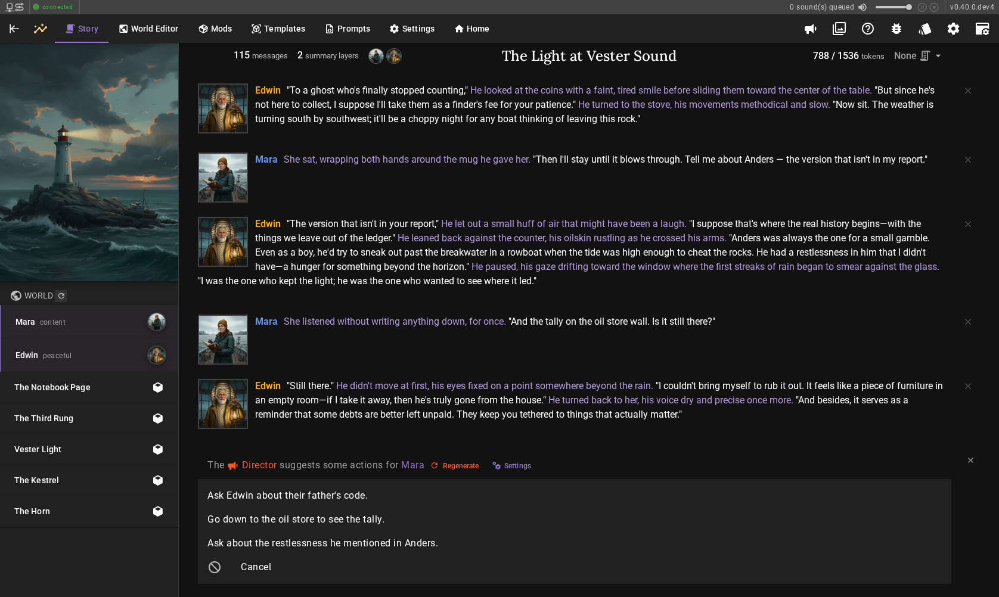
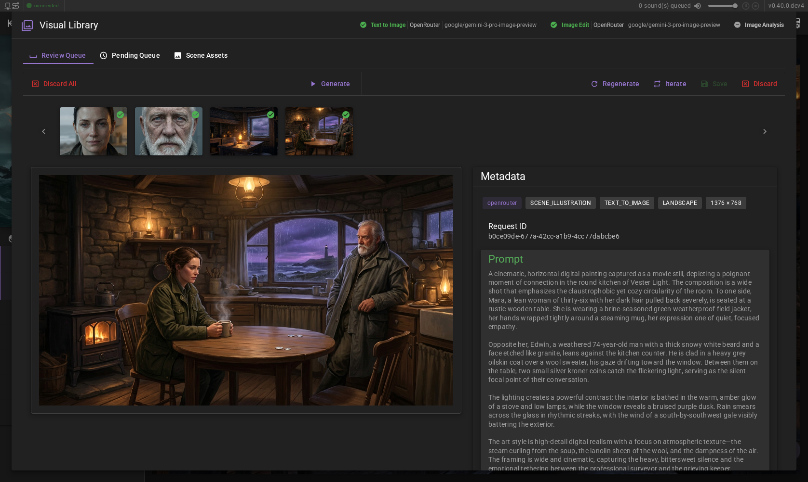
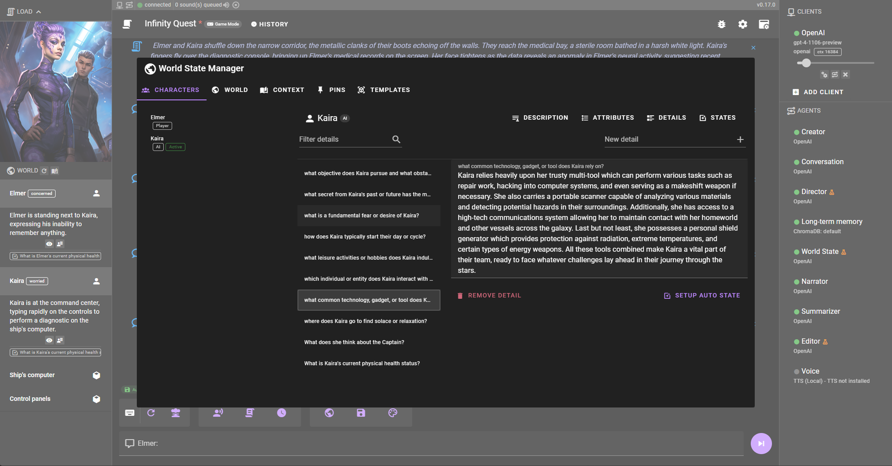
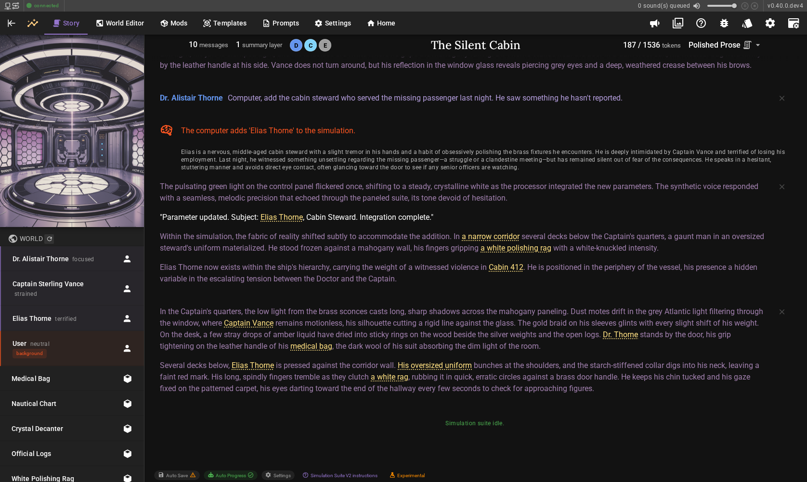

# Talemate

Roleplay with AI, with a focus on narration and consistent world and game state tracking.

|||
|------------------------------------------|------------------------------------------|
|||

## Core Features

- Agents for dialogue, narration, summarization, scene direction, editing, world state tracking, character and scenario creation, text-to-speech, image generation, and answering questions about Talemate itself
- A separate client and model per agent, with optional per-scene agent settings
- Long-term memory, layered history summaries and tracking of the passage of time
- Tracked character and world states, pins and game state variables that are kept in the AI's context
- [Character knowledge](https://vegu-ai.github.io/talemate/user-guide/world-editor/knowledge/): characters know only the passages they were present for and the information shared with them, with Learn / Never Learn rules for exceptions
- [Character perspectives](https://vegu-ai.github.io/talemate/user-guide/perspective-view/) (optional mode): each character keeps their own account of events, used for their memories and summaries and readable beside the story
- [Decision model](https://vegu-ai.github.io/talemate/user-guide/app-settings/decision-model/) (optional): a small model answers questions about the story with a probability, so other agents can skip or choose without a full request; every answer is listed in a Decision Log
- [Director chat](https://vegu-ai.github.io/talemate/user-guide/agents/director/chat/) to query and change the scene in conversation, and optional autonomous scene direction
- World editor for characters, world entries, history, pins and the context database, with AI-assisted character and scenario creation from templates and character card import
- Image generation for character portraits, scene illustrations and backdrops, managed in a visual library
- Text-to-speech with per-character voices and several local and remote backends
- [Node editor](https://vegu-ai.github.io/talemate/user-guide/node-editor/) for scene logic and reusable modules
- [Scene revisions](https://vegu-ai.github.io/talemate/user-guide/restoring-scenes/) to browse saved states per message and fork a new save from any of them, and [replay](https://vegu-ai.github.io/talemate/user-guide/replay/) to step through a story one passage at a time
- [Prompt manager](https://vegu-ai.github.io/talemate/user-guide/prompts/): every prompt is a Jinja2 template that can be overridden
- [Themes](https://vegu-ai.github.io/talemate/user-guide/templates/themes/): light and dark themes, and your own themes edited with a live preview
- [Help agent](https://vegu-ai.github.io/talemate/user-guide/agents/help/) that answers questions about Talemate from the bundled documentation and, with your permission, changes settings, themes and templates

## Documentation

- [Installation and Getting started](https://vegu-ai.github.io/talemate/)
- [Model expectations](https://vegu-ai.github.io/talemate/getting-started/model-expectations/) - what Talemate needs from your model
- [User Guide](https://vegu-ai.github.io/talemate/user-guide/interacting/)

## Discord Community

Need help? Join the [Discord community](https://discord.gg/8bGNRmFxMj)

## Supported APIs

- [OpenAI](https://platform.openai.com/overview)
- [Anthropic](https://www.anthropic.com/)
- [Google Gemini](https://ai.google.dev/) (Gemini API key or Vertex AI)
- [mistral.ai](https://mistral.ai/)
- [Cohere](https://cohere.com/)
- [Groq](https://groq.com/)
- [DeepSeek](https://platform.deepseek.com/)
- [OpenRouter](https://openrouter.ai/)

Supported self-hosted APIs:
- [llama.cpp](https://github.com/ggml-org/llama.cpp) (`llama-server`)
- [KoboldCpp](https://koboldai.org/cpp) ([Local](https://koboldai.org/cpp), [Runpod](https://koboldai.org/runpodcpp), [VastAI](https://koboldai.org/vastcpp), also includes image gen support)
- [oobabooga/text-generation-webui](https://github.com/oobabooga/text-generation-webui) (local or with runpod support)
- [LMStudio](https://lmstudio.ai/)
- [TabbyAPI](https://github.com/theroyallab/tabbyAPI/)
- [Ollama](https://ollama.com/)

Other clients:
- [OpenAI compatible](https://vegu-ai.github.io/talemate/user-guide/clients/types/openai-compatible/) - any server with an OpenAI-style completions or chat completions API, for example [DeepInfra](https://deepinfra.com/)
- [Pi Bridge](https://vegu-ai.github.io/talemate/user-guide/clients/types/pi-bridge/) - runs generations through the [pi coding agent](https://github.com/earendil-works/pi), which handles provider authentication and model selection
