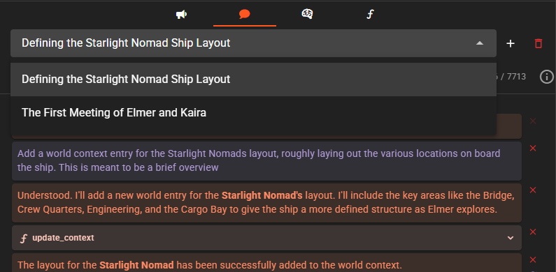

# Director Chat

!!! example "Experimental"
    Currently experimental and may change substantially in the future.

Introduced in version 0.33.0 the director chat feature allows you interact with the director agent directly once a scene is loaded.

As part of the chat session the director can query for information as well as make changes to the scene.

!!! warning "Strong model recommended"
    In my personal testing I've found that while its possible to have a coherent chat session with weaker models, the experience is going to be
    significantly better with [reasoning enabled](/talemate/user-guide/clients/reasoning/) models past the 100B parameter mark.

    This may change as smaller models get stronger and your mileage may vary.

!!! info "Chat settings"
    You can customize various aspects of the director chat behavior in the [Director Chat settings](/talemate/user-guide/agents/director/settings/#director-chat), including response length, token budgets, and custom instructions.

## Accessing the director chat

Once a scene is loaded click the **:material-bullhorn:** director console icon in the top right corner of the screen.

The icon is not there while a [playthrough](../../playthrough.md) is running — that mode replays the scene and adds nothing to it, so the console is put away until you leave it.

## Chat interface

The director chat provides a conversational interface where you can ask the director to perform various tasks, from querying information about your scene to making changes to characters, world entries, and progressing the story.

### What can you ask the director to do?

The director can help you with many tasks:

- Progress the story by generating new narration or dialogue
- Answer questions about your characters, world, or story details
- Create or modify characters, world entries, and story configuration
- Advance time in your story
- Manage game state variables (if your story uses them)
- Generate images and illustrations (if the [Visualizer Agent](/talemate/user-guide/agents/visualizer) is configured)
- Decide who knows what: set the Known by of a sheet entry or world entry, grant or revoke a character's knowledge of an entry, and ask what a character knows (see [Knowledge](/talemate/user-guide/world-editor/knowledge/#the-director))

Simply describe what you want in natural language, and the director will figure out how to accomplish it.

Knowledge changes use **Update Context → Existing Characters**, including changes
to who knows a world or history entry. Give one instruction, such as “Make the
Hidden Door private, then let Alice know about it.” With write confirmation
enabled, each concrete change asks for approval. In Character perspectives,
sharing information creates a disclosure; revocation and forgetting are
unavailable. **Query → Character Knowledge** remains the way to inspect what a
character knows.

!!! tip "Visual Generation"
    When asking the director to create images, the generated visuals can appear in your scene feed as [inline visuals](/talemate/user-guide/inline-visuals). This is controlled by the **Auto-attach visuals** setting in the scene tools visualizer menu.

### Viewing action details

When the director performs an action, you can expand it to see exactly what was done:

This gives you full transparency into the changes being made to your scene.

## Chat modes

The director chat supports three different modes that control how the director behaves:

!!! note
    Chat mode behavior is not guaranteed and depends heavily on the model's ability to follow instructions. Stronger models, especially those with reasoning capabilities, will respect these modes much more consistently than weaker models.

### Normal mode

The default mode where the director can freely discuss the story and reveal information. It will ask for clarification when needed and take a more conversational approach.

### Decisive mode

In this mode, the director acts more confidently on your instructions and avoids asking for clarifications unless strictly necessary. Use this when you trust the director to make the right decisions autonomously.

### No Spoilers mode

This mode prevents the director from revealing information that could spoil the story. The director will still make changes and answer questions, but will be careful not to discuss plot points or details that should remain hidden.

## Write action confirmation

By default, the director will ask for confirmation before performing actions that modify your scene (like progressing the story or making significant changes).

You can toggle this behavior to allow the director to act without confirmation:

!!! tip
    Keep confirmation enabled when experimenting or when you want more control over changes. Disable it when you trust the director to act autonomously.

### Confirmation workflow example

When confirmation is enabled, the director will describe what it plans to do and wait for your approval:

The confirmation dialog shows the instructions that will be sent and the expected result:

Once confirmed, the action executes and new content is added to your scene:

The director then analyzes the result and discusses what happened:

### Rejecting actions

Each confirmation offers two ways to reject a proposed call:

- **Reject and abort** stops the batch and ends the turn. This is the default rejection. A chat note lists the calls already applied and those not applied, including their arguments. Earlier changes remain applied.
- **Reject with instructions** opens a text field for your correction. Type the correction, then choose **Reject with instructions** again or press **Enter** to skip this call and continue the rest of the batch. **Confirm** is disabled while the field contains text; clear it to approve the original call. **Shift+Enter** adds a new line. After the current prompt finishes, the director receives one follow-up request containing all rejected calls, their arguments and your instructions. You can reject proposals in that follow-up the same way. Each further correction round requires another explicit rejection with instructions.

Enter the correction, then choose **Reject with instructions** or press **Enter**:

When you abort, the director waits for your next instruction. The batch note starts collapsed; its header counts applied and unapplied calls, including nested calls. Select the header to expand the full details:

### Confirmation timeout

!!! info "New in 0.37.0"

Each confirmation card shows a countdown timer in the top-right corner. The number turns red when less than 30 seconds remain.

If the timer runs out, the batch stops and the chat note identifies the calls not applied because of the timeout. No correction request runs. This has the same stopping behavior as **Reject and abort**.

The default timeout is **3 minutes**. You can change it (or disable it entirely) from the [Director Chat settings](/talemate/user-guide/agents/director/settings/#action-confirm-timeout).

Interrupting generation or closing the scene cancels a pending confirmation. The call is reported as interrupted. API calls that clear or delete a chat also cancel its pending confirmation, and the notes and results of that batch are not added back. The console does not offer a clear control and disables deletion while busy. A confirmation received before the final timeout check is accepted.

### Partial batches and reported problems

If a model proposes more calls than an action's call limit allows, the chat note lists the applied calls and those omitted because of the limit. Nested action outcomes appear under their enclosing call, so the note retains both the requested action and its individual results. Calls omitted by the executor are not automatically retried. Instruct actions also offer a `report_issue` function for the model to explain tasks it cannot fulfill; reporting a problem does not consume the action's call budget.

## Enabling and Disabling Actions

The director has access to many different actions for querying information, making changes, and progressing your story. You can control which actions the director is allowed to use by enabling or disabling them through the Actions menu.

### Accessing the Actions Menu

Click the **Actions** button in the chat toolbar to open the actions menu.

### Available Actions

The menu lists all actions grouped by category. Each action has a checkbox indicating whether it is enabled (checked) or disabled (unchecked).

Actions are organized into groups:

| Group | Actions |
|-------|---------|
| **Direct Scene** | Advance time, Create new narration, Direct character action, Yield to User |
| **Query** | Query World Information, Retrieve Context Directly, Query Game State, Query Scene Direction, Character Knowledge |
| **Update Context** | Existing Characters (including knowledge changes), World Information, Story Configuration, Static History, Character Creation |
| **Gamestate** | Make Changes (game state variables) |
| **User Interaction** | Prompt for text input (Scene Direction only) |
| **Visuals** | Create new Image(s), Edit Image(s) |
| **Misc** | Directly Retrieve Context |

!!! note "Scene Direction Only Actions"
    Some actions are only available during autonomous Scene Direction, not in Director Chat. The **Prompt for text input** action is one example - it allows the director to request information from you during autonomous direction but is not used during interactive chat sessions. See [Prompting the User for Input](/talemate/user-guide/agents/director/scene-direction/#prompting-the-user-for-input) for more details.

### Toggling Actions

Click on an action in the list to toggle it on or off:

- **Enabled** (checked): The director can use this action when responding to your requests
- **Disabled** (unchecked): The director will not use this action, even if it would be helpful

When you disable an action, the director will work around it by using other available actions or by informing you that it cannot complete the requested task.

### Locked Actions

Some actions may be marked as "locked" and cannot be disabled. These are core actions required for the director to function properly. Locked actions appear grayed out in the menu and cannot be toggled.

### Persistence

Your action toggle settings are saved with the scene. When you reload the scene later, your enabled and disabled actions will be restored automatically.

## Director personas

You can customize the director's personality and initial greeting by assigning a persona:

Personas can completely change how the director presents itself and communicates with you:

To create or manage personas, select "Manage Personas" from the persona dropdown. You can define a custom description and initial chat message for each persona.

## Multiple Chats

The director chat supports multiple concurrent conversations. Each chat maintains its own independent message history, mode, confirm-write-actions setting, and auto-generated title.

### Creating a New Chat

Click the **New Chat** button in the chat toolbar to create a fresh conversation. The new chat opens immediately and starts with the director's greeting message.

### Switching Between Chats

Use the chat selector in the toolbar to switch between existing conversations. Each chat is listed with its auto-generated title. Selecting a different chat loads its full message history and restores its mode and settings.

### Auto-Generated Titles

After the first exchange in a new chat, the director automatically generates a descriptive title based on the conversation topic. This makes it easy to identify and switch between chats covering different topics.

### Per-Chat Settings

Each chat maintains its own independent settings:

- **Chat mode** (Normal / Decisive / No Spoilers) -- set the mode independently per chat
- **Confirm write actions** -- enable or disable action confirmation per chat

This means you can have one chat in Decisive mode for rapid scene changes while keeping another in Normal mode for exploratory questions.

### Deleting a Chat

To delete a chat you no longer need, use the delete option in the chat selector. After deletion, the most recently active remaining chat is automatically selected. If no chats remain, a new one is created automatically.

### Concurrent Query Execution

The director's **Query** action supports concurrent execution. When the director needs to gather information from multiple sources (for example, querying world information and character details simultaneously), these queries can run in parallel rather than sequentially. This results in faster responses when the director needs to consult multiple information sources to answer your questions.
