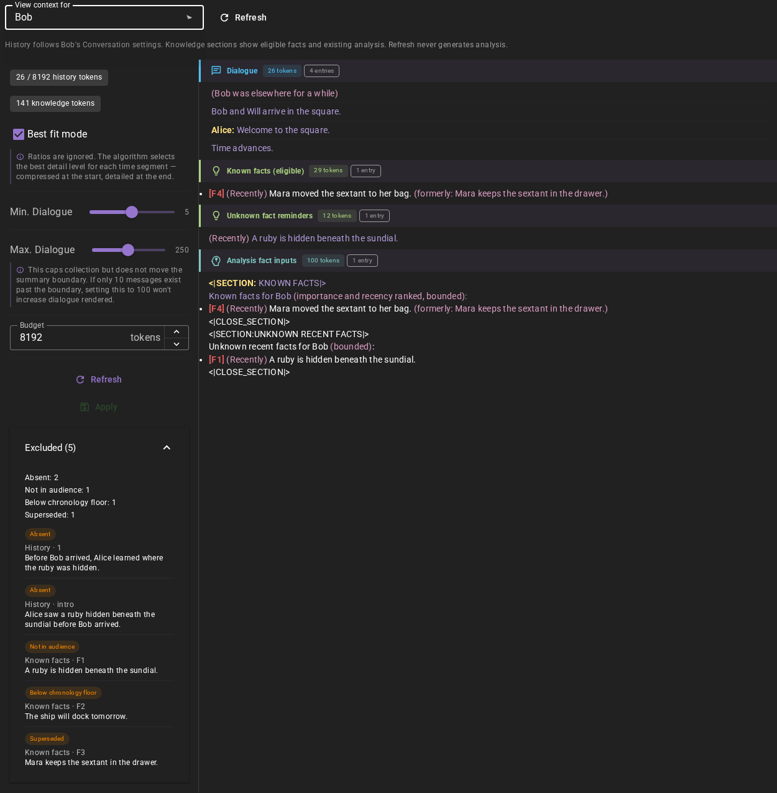

# Scene Context History Review

The Scene Context History Review panel shows how history is assembled for the scene or a selected character. It uses the conversation history selection path and shows the rendered text in sections with token counts and adjustable budgets. Character previews also show eligible knowledge and existing analysis, without generating a reply or requesting new analysis.

## Accessing the Review Panel

The context review panel is available as the **Scene Context** tab within the [Prompt Manager](index.md). It is only active when a scene is loaded.

1. Open the **Prompt Manager** from the application toolbar
2. Click the **Scene Context** tab
3. The initial context preview loads automatically
4. Under **Preview for**, choose **Scene** or an active character

The tab has two parts that do different things:

- **The view toolbar** at the top only changes what the preview shows. **Preview for** picks the perspective, the chips show the token use of the preview, and **Refresh** builds the preview again. Nothing here changes a setting.
- **The Scene history settings card** on the left holds the Summarizer settings that decide how Talemate builds the scene history for every agent: the **Format** and the history budget settings. A change here is a real settings change.

## Scene history settings

The card shows the settings of the [Summarizer's Scene History](/talemate/user-guide/agents/summarizer/settings/#scene-history) section, starting with the scene context **Format** (Screenplay, Chat (legacy), Narrative or AI Aware). The information icon next to a setting explains it.

### Where a setting comes from

Each setting shows where its value comes from:

- **Global** — the value comes from your global Summarizer settings and is used by every scene. Click **Global** to make a scene override for this setting. The override starts with the current value.
- **Scene** — this scene overrides the setting. Click **Scene** to use the global value again.

The top of the card counts the scene overrides. **Use global** removes all of them at once.

A change always goes where the setting shows it comes from. Say Mara's story needs a smaller history budget, but your other stories should keep 8192 tokens: click **Global** next to **Max. Budget**, then set 4096. Only this scene uses 4096. If you change the **Format** while it shows **Global**, every scene that has no override of its own uses the new format.

The card and the [Summarizer settings page](/talemate/user-guide/agents/summarizer/settings/) always show the same values and overrides: a change in one shows in the other without a reload.

### Saving

A change is saved at once; there is no Apply button. A list or a checkbox saves when you change it. A slider saves when you release it, or a moment after you move it with the arrow keys. **Max. Budget** saves when you click its arrows, press Enter or leave the field; a value outside the allowed range is set to the nearest allowed value. A small spinner shows while the change is saved, and the preview refreshes after it is saved.

If a change cannot be saved, the setting goes back to the saved value and the card shows the reason. Choose the value again to retry.

A scene override is stored with the scene. If the story has never been saved, Talemate asks you to save it first; until then the card shows the waiting change with **Save and apply** and **Discard change**.

## Character previews

**Scene** (the default) keeps the shared scene preview. Selecting a character uses that character's Conversation settings: Standard presence and knowledge filtering, or stored character views and audience summaries in Character perspectives. Introductions follow their recorded opening audience, so a character who arrives later does not receive the opening. A selected summary that contains the opening needs no separate introduction or token reservation. The Scene preview follows the shared author-facing rule: a separate introduction appears only when no summaries or dialogue expanded from them are selected.

In Character perspectives mode the character view adds **Analysis evidence**. **Cached analysis** appears only when a current result already exists. Its compact evidence summary names the authored inputs, world-state snapshot, disclosures, selected history identities, token budget and enforced boundary. **Show full analysis evidence** expands the exact original evidence locally, with its own token count; it does not make another request. Hidden history is excluded from both knowledge totals and evidence.

These are eligible context inputs, not a replay of a previously generated reply; dynamic memory retrieval and new analysis are not run by Refresh. If required perceptions are still running, failed or deferred, the preview says so explicitly and refreshes once when the matching work becomes ready, while keeping the selected character and the previous preview.

The **Excluded** panel under the settings card lists passages with a reason, including **Absent**, **Not in audience** and **Over token budget**. Archive and layer exclusions retain their source identities. Counts cover all recorded exclusions; the panel shows up to 20 shortened samples per reason. Each item names the section it was excluded from. Excluded text is inspection information for you; it is not appended to the character's rendered history.

**Refresh** keeps the selected character. The history settings apply to the whole scene, for every character: selecting a character does not create character-specific budget settings or change what that character knows.

## Understanding the Preview

The preview displays the context broken into color-coded sections:

### Section Types

| Section | Color | Description |
|---------|-------|-------------|
| **Layered History** | Purple | Compressed summaries from the layered history system. Earlier events are more heavily compressed. |
| **Archived (Base Summarization)** | Orange | Standard summaries of archived dialogue, providing moderate detail for recent past events. |
| **Dialogue** | Blue | Recent verbatim dialogue and narration from the scene history. |
| **Introduction / Disclosures** | Blue / Green | Eligible opening text and disclosures in Character perspectives. |
| **Analysis** | Teal | Existing analysis and the evidence used for character analysis; no analysis is generated by the preview. |

Each section header shows:

- **Section label** with an icon
- **Token count** for that section
- **Entry count** (number of individual entries in the section)
- **Budget** allocated to the section (when applicable)
- **Incomplete** warning if the section could not fit all available content within its budget

History token usage appears against the history budget in the view toolbar. Supplemental knowledge and analysis tokens are shown separately because these sections use their own bounded inputs.

## Adjustable Settings

The settings card provides the controls that determine how the context budget is distributed across sections. Each change is saved at once and the preview refreshes after it.

### Best Fit Mode

When enabled, best fit mode automatically distributes the budget across all history layers to cover the full timeline with a detail gradient -- compressed summaries at the start, full dialogue at the end. This mode replaces manual dialogue and detail ratio sliders with automatic optimization.

!!! tip "Recommended for most users"
    Best fit mode is the easiest way to get good context coverage. It automatically balances compression and detail to make the best use of your available budget.

When best fit mode is enabled, two additional controls become available:

- **Min. Dialogue Messages** -- minimum number of recent dialogue messages to always include (0-15)
- **Max. Dialogue Messages** -- maximum number of dialogue messages to include (10-500)

### Manual Mode Settings

When best fit mode is disabled, you have direct control over the budget distribution:

##### Dialogue Ratio

Controls what percentage of the total budget is allocated to verbatim dialogue (10%-90%). Higher values preserve more recent conversation at the expense of summarized history.

##### Summary Detail Ratio

Controls what percentage of the summary budget is allocated to detailed (base layer) summaries versus compressed (layered) summaries (10%-90%). Higher values favor more detailed summaries.

##### Enforce Summary Boundary

When enabled, strictly enforces the boundary between dialogue and summary sections. Without enforcement, sections may borrow unused budget from each other for a more flexible distribution.

!!! warning
    Enabling enforce boundary can result in wasted budget if one section does not need its full allocation while another is truncated.

### Max. Budget

The maximum number of tokens to allocate for scene history context (0-262144). Character previews use the Conversation client’s context window when set to 0, and cap a positive budget at that window. The shared Scene preview uses 8192 tokens when set to 0. The actual budget used during generation is determined by the client's context window minus other prompt components.

Character perspectives select stored views with the same controls. With Best Fit enabled, Min. Dialogue Messages reserves that many recent visible stored message views even when the scan crosses a summary boundary. This floor can exceed the token budget; absent or unavailable passages are never invented to satisfy it. Max. Dialogue Messages caps raw message detail. With Best Fit disabled, Dialogue Ratio, Summary Detail Ratio and Enforce Summary Boundary divide the character's stored raw and summary views just as they do for the shared Scene view.

## Workflow

A typical workflow for tuning context settings:

1. **Open the review panel** to see the current configuration
2. **Examine the sections** to see how your history is distributed
3. **Decide where a change belongs** -- keep a setting **Global** to change it for every scene, or click **Global** to override it for this scene only
4. **Adjust settings** in the settings card; each change is saved and the preview refreshes
5. **Check for warnings** -- look for "incomplete" badges on sections, which indicate content was truncated
6. If the context history is incomplete, reduce the detail ratio or increase the budget
7. **Use global** when you want this scene to follow your global settings again

## Related Documentation

- [Prompt Manager](index.md) -- the parent interface containing the context review panel
- [Summarizer Agent Settings](/talemate/user-guide/agents/summarizer/settings/) -- the underlying settings that this panel configures
- [World Editor History](/talemate/user-guide/world-editor/history/) -- managing history entries and layered history
