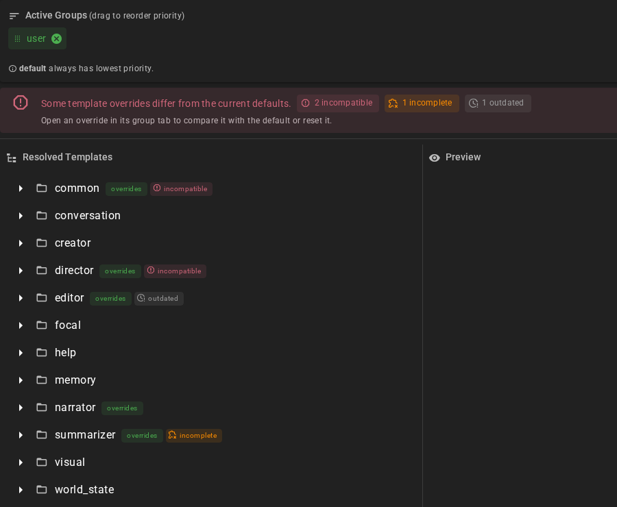
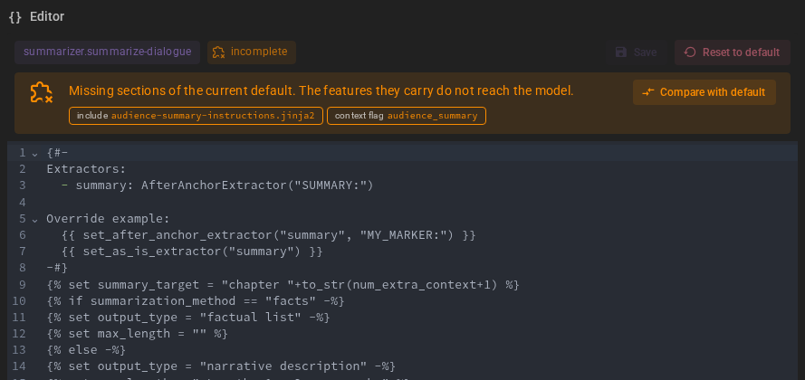
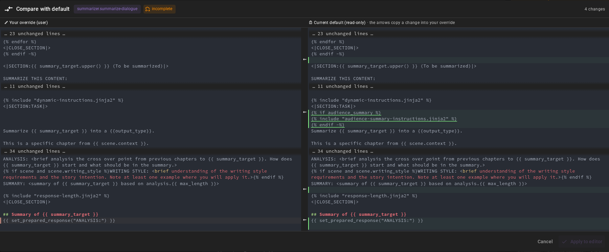

# Template Overrides

A template override is your own copy of a default prompt template. Talemate uses the copy instead of the default wherever that template is rendered, for example to change how the narrator is asked to describe a scene. Overrides live in an editable [template group](index.md#template-groups): **user**, **scene** or a custom group. The [priority order](index.md#priority-order) decides which copy wins when several groups have one.

## Override a default template

Templates in the `default` group are read-only. To change one, make a copy in an editable group:

1. Open **Prompts → Template Files → Active** and locate the template you want to customize.
2. View its content in the default group.
3. Switch to the target group tab, for example **user**.
4. Create a new template with the same agent directory and filename.
5. Paste and change the content.

To edit an existing override, open its group tab and select the file. The built-in editor opens with the full Jinja2 source. To go back to the default, click **Reset to default**: it removes your copy, and the confirmation names the source Talemate uses next (another active group's copy, or the default).

Templates are standard Jinja2 files with access to Talemate's template context variables and functions. The [template function reference](/talemate/user-guide/node-editor/reference/template_functions/) lists the functions.

## Keep overrides current

A new Talemate version can change a default template that you have overridden. Your copy keeps the old wording and misses the change. Talemate compares each override with the default it replaces and marks it with one of three states:

| State | What it means |
|---|---|
| **outdated** (grey, clock) | The file is older than the default. It may miss improvements, but nothing it depends on is gone. |
| **incomplete** (orange, puzzle piece) | The default includes a section or checks a setting that your copy does not. The feature behind it does not reach the model. |
| **incompatible** (red) | The default asks the model for a marker Talemate reads from the response, or makes a call Talemate requires, and your copy does not. Results from this template can come back empty or be rejected. A copy that [defines its own extractor](redefining-response-extraction.md) for that response field and asks for its marker is not flagged. |

For example, the summarizer's `summarize-dialogue` default includes `audience-summary-instructions.jinja2` when a summary is written for one character's point of view. A copy made before that section existed is marked **incomplete**: its summaries ignore what that character could know. A `guide-conversation` copy that asks for `GUIDANCE:` instead of a `<GUIDANCE>` block is **incompatible**: Talemate cannot find the guidance in the answer.

The **Prompts** tab icon in the main navigation and the **Active** tab show the worst state among your active overrides, and the tree marks each template and its folders. Hover a state to see what is missing. The same list appears in the backend log at startup.



Open an override in its group tab to fix it. The editor names what is missing and offers two ways out:

- **Compare with default** opens your copy beside the current default, with the differences highlighted and unchanged parts folded away. The arrows between the two sides copy a change from the default into your copy. **Apply to editor** puts the result in the editor; save it there to keep it. Compare is available for every override that has a default, whatever its state.
- **Reset to default** removes your copy.





If an override still produces an empty result while you play, Talemate shows a warning that names the template and the group it came from, for example when the override never asks the model for the marker the answer is read from. Each template warns once per session.

## World snapshot overrides

World snapshot overrides must use `snapshot_request.context_history(...)` to supply their broad story history after memory retrieval. Older copies of `world_state/request-world-state-v2.jinja2` that call only `scene.context_history(...)` cannot establish the inputs needed for safe snapshot regeneration. This also applies to `world_state/add-snapshot-entity.jinja2` overrides. The Prompt Manager marks such a copy **incompatible** and lists the missing call as a *required call*.

Put the call after the memory retrieval and any other context that can run agent actions, and render the history it returns:

```jinja2


{{ line }}

```

The call records where the story history ended when it was read. If a message arrives during memory retrieval, it becomes part of the snapshot's source; if an earlier message is edited or deleted, the result is discarded. Do not replace the call with `scene.context_history`, and do not read the history before the memory retrieval.

If Talemate reports an incompatible snapshot prompt, open **Template Files → Active** in the Prompt Manager and locate the template named in the notice. Compare it with the current default and update your override, or delete the override to restore the default. An incompatible result is not applied; Talemate makes no automatic retry.
