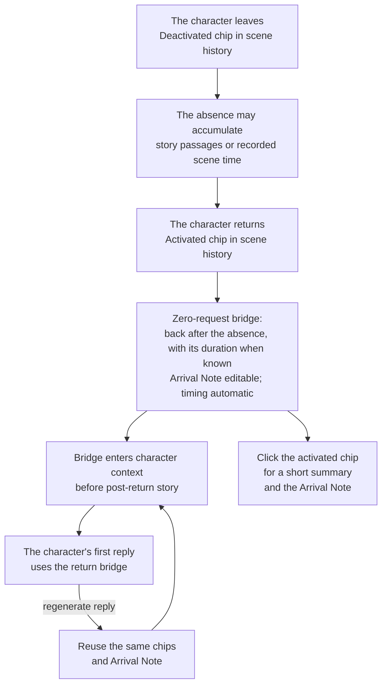
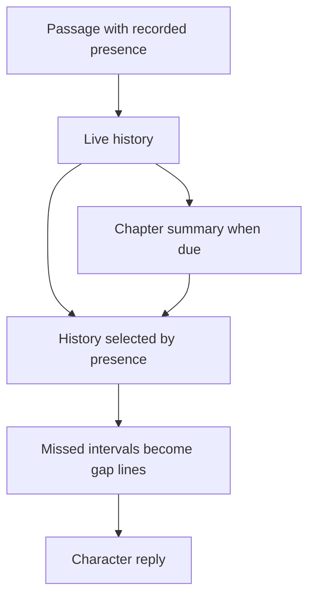
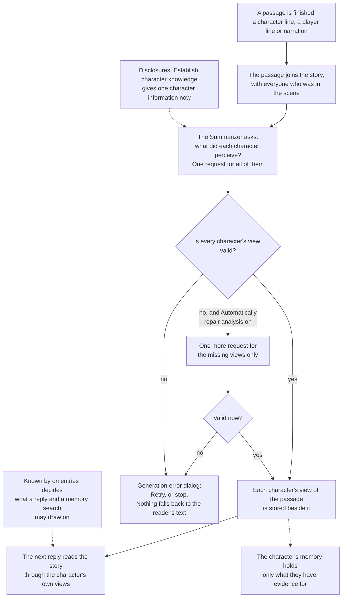
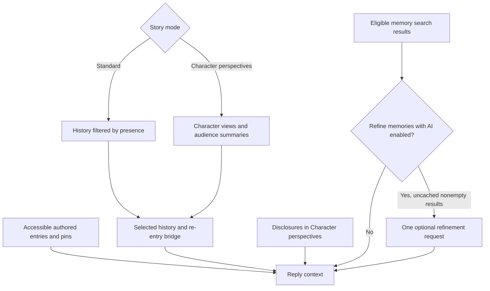

# Character knowledge: flow reference

Character knowledge is an exploratory experiment in keeping characters' knowledge separate over long-form AI storytelling. The problem is that the reader can see the whole story while each character has only lived through part of it. As the story grows, summaries and memories must preserve that distinction too. The system tries to carry those boundaries into each reply; how successfully it will do so over long stories remains to be seen. This reference is for readers who want to follow that internal flow and understand its decisions.

The diagrams trace what is recorded, which requests run, and how the results reach a character's context in each story mode. For everyday use, start with the [Knowledge guide](/talemate/user-guide/world-editor/knowledge/) or the [knowledge hub](/talemate/user-guide/world-state/#knowledge-hub). The [Conversation](/talemate/user-guide/agents/conversation/settings/#character-knowledge), [Summarizer](/talemate/user-guide/agents/summarizer/settings/#character-perspectives) and [Memory](/talemate/user-guide/agents/memory/settings/#retrieval) pages describe the individual controls.

## The pieces

- **Presence** records who was in the scene for each passage. Standard mode uses this to select history; a chapter summary records everyone present for any part of it.
- **Character views** replace reader prose in Character perspectives mode. Each view records what its audience perceived.
- **Known by** controls access to authored sheets, details, world entries, static history and pins.
- **Disclosures** establish selected information for a character in Character perspectives mode without inventing dialogue.

Your finished line appears immediately. In Character perspectives mode, dependent generation waits for its perception analysis. Browsing revisions starts no analysis; **Analyze perceptions** or sending the next line refreshes the selected version. Standard mode settles summary cleanup without a knowledge request.

## A character leaves and returns

Leaving separates what a character witnessed from what happened without them. Scene history marks the departure with a **[Name] deactivated** chip and the return with a **[Name] activated** chip, in every scene. On their return, a **re-entry bridge** connects that absence to the scene they are joining: they are now back after an absence, with its duration when scene time records one. Building this bridge adds no model request. In Standard mode the bridge requires **Limit to character knowledge** in the [Conversation settings](/talemate/user-guide/agents/conversation/settings/#character-knowledge); Character perspectives always uses it. Without it, the chips stay as markers and add nothing to any prompt.

**The return and elapsed time.** The bridge says that the character has returned after being away. If scene time advanced by two days while Edwin was away, it says “Edwin has returned to the scene after 2 days away.” The absence runs from Edwin's deactivated chip to the activated chip: a time passage placed between them counts, one placed before the deactivated chip does not, even when other characters left at the same point. When no time passage was recorded, or the departure time is unavailable, it says “after being away” without assigning a duration. This does not imply an immediate return. Editing time passages updates the duration automatically.

**Where it goes in the context.** The bridge is its own history entry at the return boundary, before the post-return story. It does not replay the last exchange before departure inside the current scene, and it does not repeat the lines that follow the return: those stay in their place in the story and reach the prompt once, as ordinary dialogue. In Standard mode the story the character missed shows once, as a line such as *(Edwin was away for a while.)*; the bridge does not repeat it either. The bridge can name the other characters already present. A return with no story after it adds no instruction to invent an entrance. The latest return stays in context until that character completes their first reply, even when older material is summarized or the history budget is tight. Later returns get their own chips and arrival notes.

**Why place the return at its history boundary?** The absence marker describes the interval the character missed; the return entry says that they are back. It does not announce a new departure at the moment of return. Keeping the post-return lines in their original place gives the next response a single, chronological copy to continue from.

**What you see and edit.** Scene history shows a deactivated chip at the departure and an activated chip at the return, each in the character's color. Click the activated chip for a short summary: *Back after 2 days away* (or *First time in the scene*), and who was present at entry. The prompt text itself is not shown. While the bridge is in use, the opened chip also offers **Arrival Note (Optional)**, for example “Edwin comes through the garden gate carrying a sealed letter.” The note is saved shortly after you leave the field and does not start a request; the field keeps its unsaved color until the save is done. The timing and the summary are read-only and keep updating from the story.

**Why chips and one editable note?** A chip marks the presence change without filling the visible story with bookkeeping. The summary says in plain words what the bridge is built from. An Arrival Note lets the author establish something new; deriving the timing from the timeline avoids a second, editable duration that could disagree after a time edit.

**What happened while away.** The return records the absence and its duration. The character's experiences during that time can emerge naturally as the story continues.

**Regeneration.** Regenerating a reply reuses the chips and Arrival Note. If an activation or deactivation left a chip after the last story passage, Regenerate still targets that story passage and preserves the chip, including when regeneration is cancelled. Loading, reconnecting and replacing an actor do not add a chip. Rewinding and deleting source messages affect their own entries, rather than attaching an old return to a different episode.

## Standard mode: one line is said

The passage records who was present. No knowledge request follows it. When enough history accumulates, the Summarizer writes a chapter summary with the same audience metadata.

A missing presence list means shared history. Everyone present sees the complete passage, including any private thoughts in the reader prose. Authored visibility and Learn / Never Learn rules separately govern entries and memories.

## Character perspectives mode: one line is said

After every passage, Talemate writes what each character perceived, and replies are built from those views.

**The passage joins the story** with who was in the scene. Character lines, player lines, narration and tracker answers are passages; director notes are not.

**What did each character perceive?** One request covers every active character and everyone present. Each gets a standalone view of what they could perceive, or an omitted view if nothing. The reader keeps the complete prose.

**Repair and Retry.** When a view is missing or unreadable, **Automatically repair analysis** (on by default) sends one more request for it. If it still fails, the generation error dialog offers **Retry**; Cancel or Ignore stops the dependent generation. A character never falls back to the reader's text.

**Why store views and stop on missing evidence?** Presence alone cannot separate two characters' experiences of the same passage. Stored views make those differences available to later replies and summaries. Falling back to the reader's complete text after a failed view would undo that separation exactly when the evidence is missing; repair and explicit Retry address the missing view instead.

**Private entries.** **Known by** decides which entries a reply and a memory search can draw on. Perception analysis still reads every sheet as background. It excludes the scene description, but dialogue and guidance still receive it. Keep real secrets out of the scene description, story intention, current scene intention and sheet text.

**Disclosures.** **Establish character knowledge** in the Knowledge tab gives a character selected information, or a whole entry, at this point in the story, without inventing dialogue. The director can do the same.

**Why explicit visibility and disclosures?** A sheet or world entry can exist before the story establishes who knows it. Visibility lets the author define that access, while a disclosure records a deliberate change in knowledge at a specific moment without fabricating a conversation.

**What the character remembers.** Their views, audience summaries and disclosures, plus authored entries they may know. Similarity ranks these eligible memories; it cannot grant access.

The perception request includes prior character views, disclosures and short scene intentions. It retains source IDs for provenance and invalidation. It does not require markup or a fixed prose shape; double quotes identify dialogue. The model must preserve a public interaction's concrete subject and speech act in each replacement view while leaving private content out.

## What a character's reply is built from

Chapter summaries compress history. Character perspectives groups equivalent audience inputs for summaries, preserves explicit omissions and repairs missing groups without exposing reader prose. Standard summaries use their recorded presence. Retrieval respects those boundaries before ranking; optional recency, diversity and local reranking affect relevance only.

## The effort slider and what it switches

The [effort tables](/talemate/user-guide/world-editor/knowledge/#effort-presets) list every stop, its request cost and the creation defaults. Standard offers **Off**, **Minimal** and **Thorough**. Character perspectives offers **Minimal**, **Balanced** and **Thorough**. The optional switches are memory refinement and, in Character perspectives, automatic repair of missing or invalid views. The required perception and audience-summary requests remain part of that mode.

## Which mode to pick

You choose the mode when you create the story; Scene Settings can change it until the story has lines or summarized chapters.

**Standard** adds no mandatory perception request after each passage; a present character receives the full reader prose, with Learn / Never Learn rules for recorded knowledge access. Optional AI memory refinement has its own request cost. **Character perspectives** builds replies from recorded views, aiming to preserve differences between characters' experiences. It adds one request per passage, needs a [strong model](/talemate/getting-started/model-expectations/) and cannot be turned off once the story has history. [Choosing a mode](/talemate/user-guide/world-editor/knowledge/#choosing-a-mode) has the full comparison, and **Compare modes** shows the same two cards wherever the mode is named in the interface.

**Why keep both approaches?** Standard reuses shared prose and offers explicit knowledge controls; Character perspectives records a separate evidential view before later generation depends on it. That adds requests and a larger derived record in exchange for more explicit separation. The mode decision is about which experiment fits the story and its cost, not a guarantee that either approach will keep every secret or inference correct.
