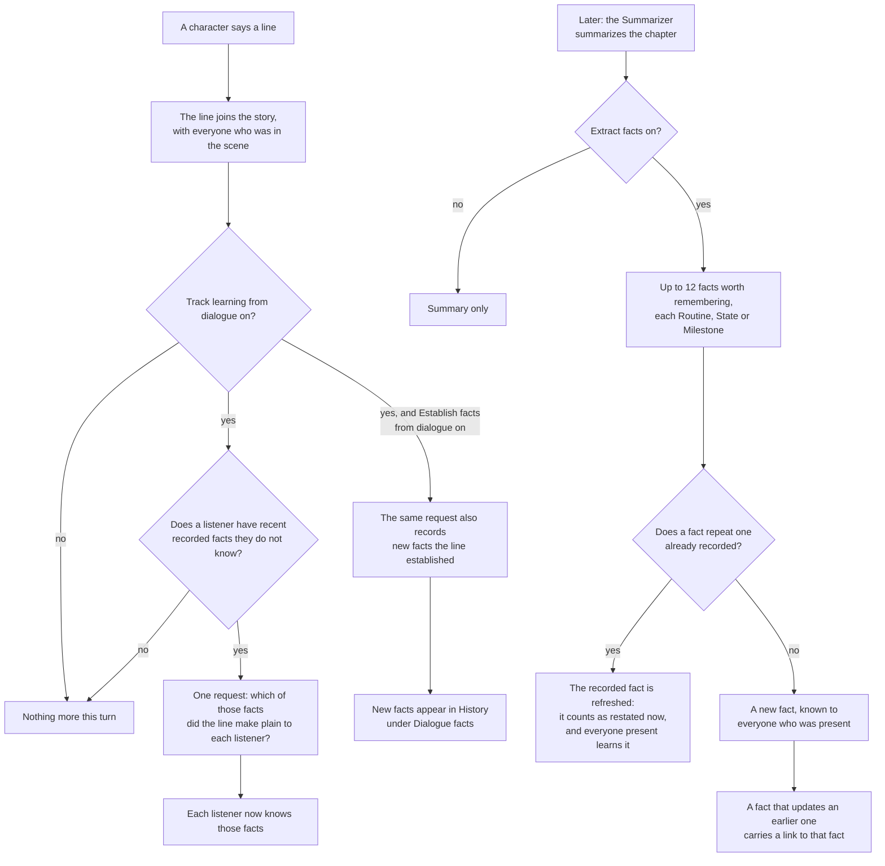
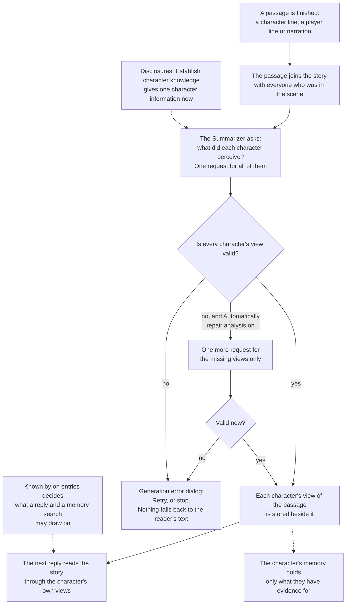
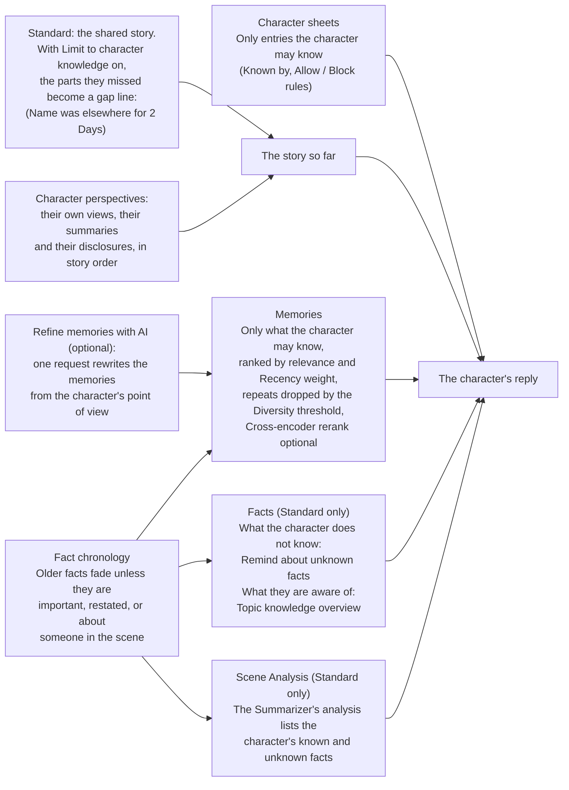
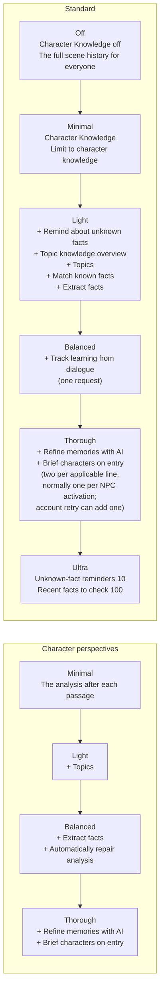
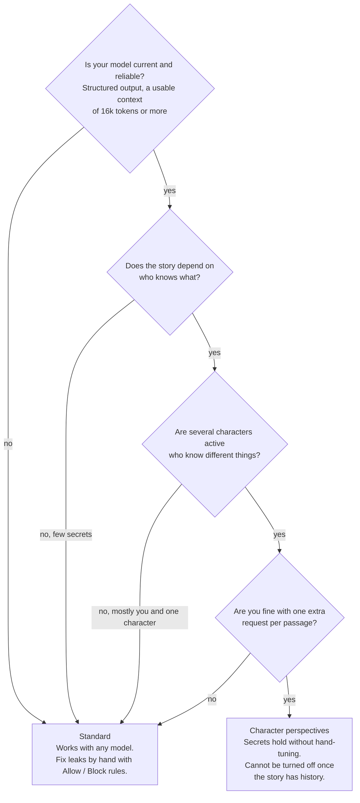

# How character knowledge works

Characters know what they were in the scene for, what you allow them to know, and what they were told. This page shows that flow, turn by turn, in both story modes. Settings are named as the app shows them; the [Knowledge](/talemate/user-guide/world-editor/knowledge/), [Conversation](/talemate/user-guide/agents/conversation/settings/#character-knowledge), [Summarizer](/talemate/user-guide/agents/summarizer/settings/#fact-chronology) and [Memory](/talemate/user-guide/agents/memory/settings/#retrieval) pages describe them, and the [knowledge hub](/talemate/user-guide/world-state/#knowledge-hub) gathers them in one menu.

## The pieces

Your finished line appears at once, with the spinner naming any perception or learning pass still running; the next reply waits for those passes to finish.

Browse a line's versions freely. For changed text, choose **Analyze perceptions** in Character perspectives mode or **Refresh facts** in Standard mode, or send your next line or choice to run the same required update first. History and Knowledge mark changed passages as out of date until it finishes. Reading, moving keyboard focus and changing tabs never start it.

- **Presence.** Every line records who was in the scene; a chapter summary records everyone who was there for any part of it.
- **Facts.** Short statements the Summarizer records from a chapter, each **Routine (1)**, **State (2)** or **Milestone (3)**. Edit them in [History](/talemate/user-guide/world-editor/history/#facts), or list, filter and manage them all in the [Facts tab](/talemate/user-guide/world-editor/facts/).
- **Known by.** Every sheet entry and world entry is known by everyone, only its owner (**Nobody** for a world entry), or specific characters. See [Visibility](/talemate/user-guide/world-editor/knowledge/#visibility).
- **The character's knowledge.** All of the above plus what the story taught them; the [Knowledge tab](/talemate/user-guide/world-editor/knowledge/#topics-and-coverage) lists it.

## A character enters

Explicitly activating a character or bringing one back starts a private arrival window for that character. Loading a save with the character already active does not. The window lasts for **Character entry turns** of that character's own completed dialogue (3 by default); prompt retries and everyone else's lines leave it alone, and a save/reload resumes the remaining count.

Before each reply in that window, Talemate rebuilds a zero-request orientation from the character's knowledge at that moment: up to twelve ranked known facts about the characters present now, the current roster, no more than five character-visible lines since entry, time since entry, and—on a return—the time since the character was last known to be present. The whole orientation has a fixed prompt-token ceiling. The entry boundary stays fixed while facts, presence and visible lines update live. Raw scene description and reader-only history are excluded. Talemate does not infer a clock time; a time of day appears only when the character knows a fact that states one. Player-controlled characters receive this orientation in context preview and AI-driven turns too.

With **Brief characters on entry** on, a non-player character's activation normally sends one request through the World State client. A readable result replaces the live orientation for the rest of the same window. Failure or cancellation does not undo the entry: the zero-request orientation remains and no briefing is saved. A player character never sends this request.

Standard stores that temporary briefing only in the Conversation prompt state. Character perspectives stores it as a disclosure to the entering character, visible under **Characters → Knowledge**. **Regenerate** replaces only that disclosure and starts a fresh turn window; **Remove** deletes only it, revealing the live orientation if the original window still has turns. Once the window has expired, removing the disclosure restores no prompt block.

If Narrator **Offscreen Life** also applies to a return, one combined request through the Narrator client produces both results and honors Offscreen Life's length and extra instructions. Its account and fact keep the same shape as usual. If only one section is readable, Talemate keeps that result and retries a missing offscreen account through its ordinary path. That fallback makes the return cost two requests. Regenerating or removing the entry briefing never changes that paired fact.

## Standard mode: one line is said

Knowledge follows presence. Two switches add learning from dialogue; the chapter summary records facts.

**The line joins the story** with the list of who was in the scene, speaker included. Everyone on the list has heard it; nobody else has. A line with no presence list counts as heard by everyone.

**Track learning from dialogue** (off by default) gathers the recent facts each listener does not know. If there are none, nothing is sent. Otherwise one request asks which of them the line made plain to each listener; those listeners now know them. A hint or a question does not count.

**Establish facts from dialogue** (shows while Track learning is on) makes the same request also record new facts the line established, after every character line. They appear in History under **Dialogue facts**.

**The chapter summary** records facts when **Extract facts** is on: up to twelve, only facts whose loss could make a later scene go wrong. Everyone present for the chapter knows them.

**Restatements.** A fact that repeats a recorded one, within the **Fact matching tolerance**, is not stored twice: the recorded fact counts as restated now, so it is [fresh again](#facts-age), and anyone present learns it.

**Linked facts.** A fact that updates an earlier one carries a link to it; History shows an arrow chip. A character who knows the newer fact no longer gets the older one in their reply; one who has not learned it still does. History and the Knowledge tab keep every fact and link.

??? note "Details"
    - A presence list is missing on lines from stories written before presence was recorded, and on lines said while no character is active; a summary that contains such a line is known to everyone.
    - The speaker learns nothing from their own line. Learned facts leave the listener's unknown-fact reminders and enter their memory.
    - A restatement keeps the fact's text, importance and original time.
    - With **Show formerly clause** on (default, under Fact chronology), a newer fact can include its immediate predecessor when both are prompt candidates, as a short *formerly* clause of at most 240 characters, with no second time marker or extra request. For A → B → C, C can show B as formerly; A is omitted. Turning the setting off removes the clause while keeping superseded facts out of the prompt for characters who know their successor.

## Character perspectives mode: one line is said

After every passage, Talemate writes what each character perceived, and replies are built from those views.

**The passage joins the story** with who was in the scene. Character lines, player lines, narration and tracker answers are passages; director notes are not.

**What did each character perceive?** One request covers every active character and everyone present. Each gets a standalone view of what they could perceive, or an omitted view if nothing. The reader keeps the complete prose.

**Repair and Retry.** When a view is missing or unreadable, **Automatically repair analysis** (on by default) sends one more request for it. If it still fails, the generation error dialog offers **Retry**; Cancel or Ignore stops the dependent generation. A character never falls back to the reader's text.

**Private entries.** **Known by** decides which entries a reply and a memory search can draw on. The analysis still reads every sheet as background, so keep real secrets out of the scene description, the story intention and the sheet text.

**Disclosures.** **Establish character knowledge** in the Knowledge tab gives a character selected information, or a whole entry, at this point in the story, without inventing dialogue. The director can do the same.

**What the character remembers.** Only what they have evidence for: their views, summaries and disclosures, the entries they may know, and the facts drawn from their views. A memory search cannot grant more.

**Shared facts.** Characters present for a passage can share facts extracted from it when their own views cite the supporting moment. If Alice's extraction records a public interaction that Bob's extraction missed, Bob can receive it as **Inferred from shared evidence**. A present subject gets the fact when their own view cites the span; otherwise not. Being named or mentioned through an alias does not override a missing citation. Pending, failed and omitted views cannot receive the fact this way.

The existing analysis marks fully perceived spans, and each extracted fact can cite one. During extraction, the embedding service compares the fact with all spans in its source, including every message feeding a chapter summary. A better match only blocks the citation when that competing span is outside the audience's perceived set. The model can therefore choose a public span containing pronouns even when another public span scores higher. Sharing requires the recipient to cite the chosen span and to have perceived every higher-scoring competitor; a private competitor in another source message can veto the transfer. Spans are never widened, and sharing adds no prose comparison, tolerance setting or generation request. This check does not prove that the model preserved every qualification. Similar-fact matching uses **Fact matching tolerance**, and a recipient who already holds a close phrasing of the same moment does not receive another row. Evidence is offered as short excerpts within the model's context budget.

In a character's **Knowledge** pane, unknown fact rows explain why: **Citation not supported** when a higher-scoring span outside the audience’s view vetoed a citation, **No contribution from [name]'s view**, **Not in their view** when a citation is missing, **Not present**, **View pending or failed**, **View being rebuilt** when evidence is stale, or **Private moment** for an explicitly omitted view. The topic count uses the same known facts as these rows.

Views saved without evidence references need their perceptions regenerated before rebuilding facts can share them. Existing scenes are not automatically reanalyzed on load or fact rebuild; each old view stays excluded from reconciliation until you regenerate it. No evidence is guessed from the old prose.

**Retired here:** Track learning from dialogue, Establish facts from dialogue, Remind about unknown facts, Topic knowledge overview and Match known facts. Block rules cannot be created. **Refine memories with AI** stays.

??? note "Details"
    - The request carries what each character already knows from the previous passages and their disclosures, so a view never invents an observation to justify knowledge.
    - When a chapter is summarized, each character gets a summary from their own views, once their views of the chapter are complete. Characters with identical views share one request. Facts belong to the extracting audience and can reach other present characters through shared evidence from the same passage; presence elsewhere in the chapter is not enough. Linked facts work as in Standard mode.
    - With **Extract facts** on, a disclosure also becomes searchable facts.

## What a character's reply is built from

**Character sheets.** Only the entries the character may know; in Standard mode an Allow rule adds one and a Block rule removes one.

**The story so far.** Standard mode uses the shared story; with **Limit to character knowledge** on, what the character missed becomes one gap line, such as *(Edwin was elsewhere for 2 Days)*. Character perspectives mode uses their own views, chapter summaries and disclosures, in story order.

**The introduction.** The opening stays with the characters active when it was established; a later arrival does not receive it through filtered history or its derived knowledge. Character perspectives shares that opening text within its recorded audience without another request. The introduction and selected history share a token budget. A character receives a separate opening only when their selected summaries do not already carry it; those summaries need no extra intro reservation. The reader retains the opening. Shared author-facing history, including the narrator and director, inserts a separate introduction only when no summaries or dialogue expanded from them are selected.

**Inspect a character's context.** In Prompt Manager → **Scene Context**, choose an active character to inspect their history, eligible facts and existing analysis. **Excluded** shows reasons and counts, including archive/layer exclusions and fact budget cuts, with bounded samples. Refresh generates no reply or analysis; Apply saves history settings scene-wide. See [Scene Context History Review](/talemate/user-guide/prompts/context-history-review/).

**Memories.** The Memory agent finds what fits the last lines among what the character may know, ranked by relevance; **Recency weight** moves newer ones up, the **Diversity threshold** drops near-repeats, and **Cross-encoder rerank** (off by default) reorders the top results locally. The result is cached until the story or the memory changes. **Refine memories with AI** adds one request that keeps the useful memories, rewritten from the character's point of view. With Character perspectives, memory brings back the character's passages that are no longer in the current story context; passages the reply prompt already renders are left out.

**Facts and reminders (Standard only).** **Remind about unknown facts** lists the recent facts the character does not know, so the AI keeps them from acting on those. **Topic knowledge overview** states which topics they know all, some or nothing of. The Summarizer's Scene Analysis, when on for conversation, lists their known and unknown facts. No request is added.

### Facts age

A fact scores its importance divided by one plus its age over its half-life: **Milestone (3)** halves every 90 days, **State (2)** every 14, **Routine (1)** every 2, counted from the last restatement. Facts newer than the **Recent facts window** (3 days) always stay eligible; older ones need a score above the **Older facts score floor** (0.5) or must concern a character in the scene. That exception matches recorded subjects and character aliases; only facts without subjects fall back to a name match in their text, so a ship fact containing “will” is not retained merely because Will is present. Rendered facts carry a time such as *(21 Days ago)*. Aging never erases knowledge; the settings sit under [Fact chronology](/talemate/user-guide/agents/summarizer/settings/#fact-chronology).

??? note "Details"
    - Director notes and the character's own state notes stay in the story part.
    - In Standard mode, **Match known facts** admits a memory of a missed event when it closely matches a fact the character knows. **Entity lookup** places a named absent character's description first. Editing a memory, a world entry or a character detail refreshes the cache.
    - The unknown-fact list takes the newest **Recent facts to check** facts, ranks them by chronology and cuts to **Unknown-fact reminders**. The topic overview needs Topics in the Memory agent.
    - With the defaults, a fact about absent people leaves the prompts after 3 days (Routine), 42 (State) or 450 (Milestone). The effort slider leaves these settings alone.

## The effort slider and what it switches

The **Character knowledge effort** slider sets the knowledge switches of the Conversation, Summarizer and Memory agents together; each stop adds to the one below it. It sits in the knowledge hub's **Thoroughness** section, the **Create New Story** dialog and the Conversation agent's settings. In the hub the switches it drives are in the **Individual settings** pane under it, which starts closed and counts how many are on. Change a switch by hand and the slider moves to the stop the settings then match, or shows **Custom** when they match none.

In Standard mode, Off is Talemate before character knowledge: every character sees the full scene history. Light adds every helper that costs no request, Balanced one request per applicable line, Thorough two per applicable line plus normally one per non-player character activation, and Ultra wider reminders. A combined Offscreen Life fallback can add one more request to a return. In Character perspectives mode the analysis is mandatory, so Minimal is the floor and there is no Off and no Ultra; Thorough adds both memory refinement and the activation briefing. A Standard scene on Off that switches modes lands on Minimal. A new story starts on Balanced; switching modes carries the stop over, and Ultra lands on Thorough. The [Effort presets](/talemate/user-guide/world-editor/knowledge/#effort-presets) tables list every switch and the model each stop asks for.

## Which mode to pick

You choose the mode when you create the story; Scene Settings can change it until the story has lines or summarized chapters.

**Standard** costs nothing extra, works with any model and locks nothing in; a present character sees the full reader prose, so leaks are yours to catch with Allow / Block rules. It is the mode to keep when the scene is mostly you and one character, where a second view of every passage buys almost nothing. **Character perspectives** grounds every reply in what the character perceived, so secrets hold; it earns its cost when several characters are active who know different things. It costs one request per passage, needs a [strong model](/talemate/getting-started/model-expectations/) and cannot be turned off once the story has history. [Choosing a mode](/talemate/user-guide/world-editor/knowledge/#choosing-a-mode) has the full comparison, and **Compare modes** shows the same two cards wherever the mode is named in the interface.
