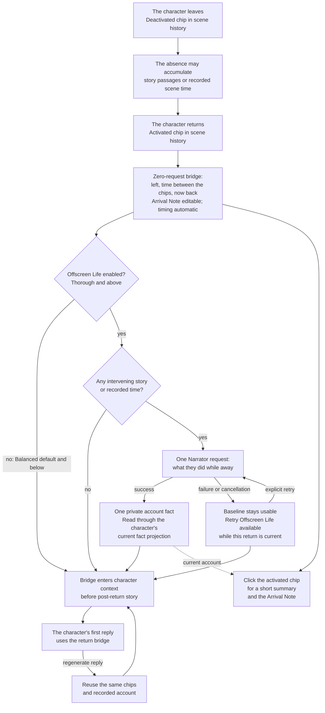
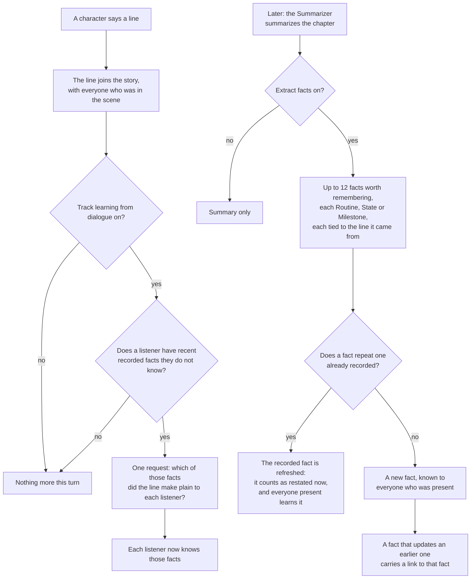
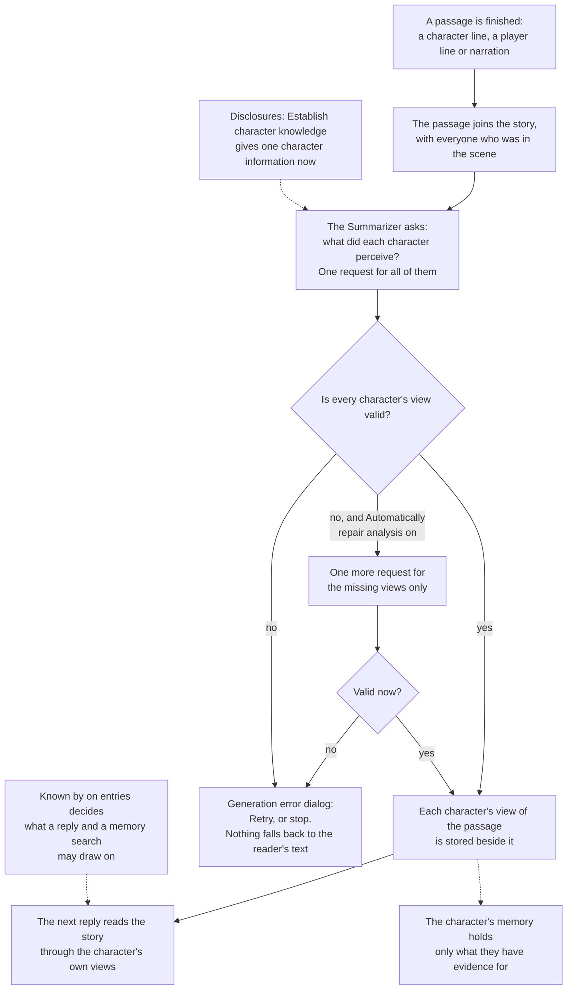
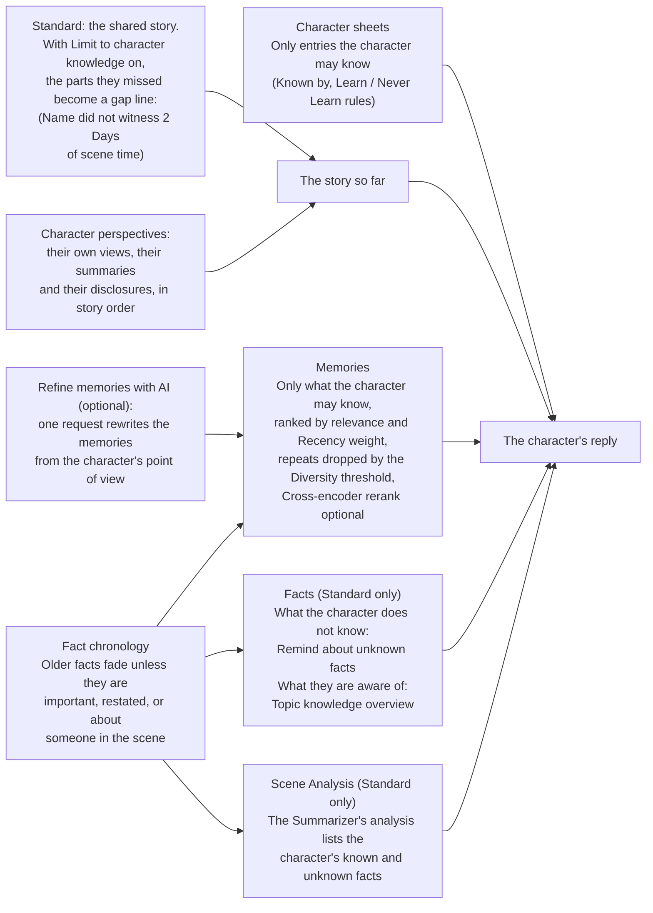
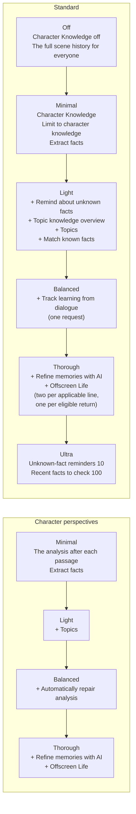

# Character knowledge: flow reference

Character knowledge is an exploratory experiment in keeping characters' knowledge separate over long-form AI storytelling. The problem is that the reader can see the whole story while each character has only lived through part of it. As the story grows, summaries and memories must preserve that distinction too. The system tries to carry those boundaries into each reply; how successfully it will do so over long stories remains to be seen. This reference is for readers who want to follow that internal flow and understand its decisions.

The diagrams trace what is recorded, which requests run, and how the results reach a character's context in each story mode. For everyday use, start with the [Knowledge guide](/talemate/user-guide/world-editor/knowledge/) or the [knowledge hub](/talemate/user-guide/world-state/#knowledge-hub). The [Conversation](/talemate/user-guide/agents/conversation/settings/#character-knowledge), [Summarizer](/talemate/user-guide/agents/summarizer/settings/#fact-chronology), [Memory](/talemate/user-guide/agents/memory/settings/#retrieval) and [Narrator](/talemate/user-guide/agents/narrator/settings/#offscreen-life) pages describe the individual controls.

## The pieces

Your finished line appears at once, with the spinner naming any perception or learning pass still running; the next reply waits for those passes to finish.

Browse a line's versions freely. For changed text, choose **Analyze perceptions** in Character perspectives mode or **Refresh facts** in Standard mode, or send your next line or choice to run the same required update first. The World Editor's History tab marks each history entry that contains such a passage with a chip that runs the same update. Reading, moving keyboard focus and changing tabs never start it.

- **Presence.** Every line records who was in the scene; a chapter summary records everyone who was there for any part of it.
- **Facts.** Short statements the Summarizer records from a chapter, each **Routine (1)**, **State (2)** or **Milestone (3)**. Edit them in [History](/talemate/user-guide/world-editor/history/#facts), or list, filter and manage them all in the [Facts tab](/talemate/user-guide/world-editor/facts/).
- **Known by.** Every sheet entry and world entry is known by everyone, only its owner (**Nobody** for a world entry), or specific characters. See [Visibility](/talemate/user-guide/world-editor/knowledge/#visibility).
- **The character's knowledge.** All of the above plus what the story taught them; the [Knowledge tab](/talemate/user-guide/world-editor/knowledge/#topics-and-coverage) lists it.

**Why record presence, facts and access separately?** Presence records who could witness a passage; a fact keeps a specific piece of information available after summarization; access settings cover information established outside dialogue. None alone answers every knowledge question. Keeping the source and the grant distinct lets a later disclosure teach a fact without rewriting who was there originally.

**Why separate browsing from analysis?** Looking at another version should not silently rewrite what characters know or start a request. Explicit analysis, or the next generation that needs it, brings the evidence up to date before that evidence is used.

## A character leaves and returns

Leaving separates what a character witnessed from what happened without them. Scene history marks the departure with a **[Name] deactivated** chip and the return with a **[Name] activated** chip, in every scene. On their return, a **re-entry bridge** connects that absence to the scene they are joining: they left, how much recorded scene time passed, and they are now back. Building this bridge adds no model request. In Standard mode the bridge requires **Limit to character knowledge** in the [Conversation settings](/talemate/user-guide/agents/conversation/settings/#character-knowledge); Character perspectives always uses it. Without it, the chips stay as markers and add nothing to any prompt.

**The departure and elapsed time.** The bridge describes the transition, not the events the character missed. If scene time advanced by two days while Edwin was away, it says that two days passed and Edwin has now returned. The absence runs from Edwin's deactivated chip to the activated chip: a time passage placed between them counts, one placed before the deactivated chip does not, even when other characters left at the same point. Story passages alone do not invent a duration: with no recorded time passage, it says so. A missing departure time is shown as unknown. Editing time passages updates the duration automatically.

**Where it goes in the context.** The bridge is its own history entry at the return boundary, before the post-return story. It does not replay the last exchange before departure inside the current scene. In Standard mode the story the character missed shows once, as a line such as *(Edwin did not witness this part of the scene)*; the bridge does not repeat it. It can add the participants at entry and up to two established arrival lines that the character is allowed to perceive. The latest return stays in context until that character completes their first reply, even when older material is summarized or the history budget is tight. Later returns get their own chips; an earlier account is not moved to a new absence.

**Why a generic bridge at the return boundary?** “Away for a while” leaves the model to guess both the transition and the duration. Stating departure, recorded elapsed time and return supplies that missing connection without asking a model to invent it. Placing the entry before the post-return story preserves the order of events. Replaying the last exchange from before departure here would mix the previous moment into the current scene, so it is left in its original place. Two permitted arrival lines provide immediate grounding without creating another history window.

**What you see and edit.** Scene history shows a deactivated chip at the departure and an activated chip at the return, each in the character's color. Click the activated chip for a short summary: *Back after 2 days away* (or *First time in the scene*), who was present at entry, and the offscreen account when one exists. The prompt text itself is not shown. While the bridge is in use, the opened chip also offers **Arrival Note (Optional)**, for example “Edwin comes through the garden gate carrying a sealed letter.” The note is saved shortly after you leave the field and does not start a request; the field keeps its unsaved color until the save is done. The timing and the summary are read-only and keep updating from the story. If an offscreen account exists, edit it separately in [World Editor → Facts](/talemate/user-guide/world-editor/facts/); the chip points to its fact ID.

**Why chips and one editable note?** A chip marks the presence change without filling the visible story with bookkeeping. The summary says in plain words what the bridge is built from. An Arrival Note lets the author establish something new; deriving the timing from the timeline avoids a second, editable duration that could disagree after a time edit.

**Offscreen Life.** This is the optional generated part of the bridge. With [Narrator → Offscreen Life](/talemate/user-guide/agents/narrator/settings/#offscreen-life) enabled, a return after any intervening story or recorded scene time adds one request about what the character did while away. It does not wait for a chapter summary. The request uses the character's permitted context and established arrival constraints, and stores the result as one private offscreen fact. It adds no separate entry briefing, fact-extraction request or perception repair. A newly created character, or an immediate leave and return with nothing between, gets no account.

**The account follows knowledge.** The bridge reads that fact through the returning character's current fact projection—the same rules that decide which facts they know—not a saved copy of its original text. Editing the fact updates what the bridge can show. When the character knows a successor, the superseded account is withheld. In Standard mode Learn, Never Learn and Unlearn rules also apply. In Character perspectives the account belongs to its owner; it does not give other characters knowledge of that private absence.

**Why one projected account?** Offscreen Life establishes what the returning character did; it does not brief them on everyone else's missed scene. Keeping one fact as its source means edits and knowledge rules still apply. A second generated briefing or copied account could disagree with that source, so there is no second generated component.

**Effort and requests.** The [effort slider](#the-effort-slider-and-what-it-switches) enables Offscreen Life at **Thorough** in both modes and **Ultra** in Standard mode. It is off at Off, Minimal, Light and Balanced. **Balanced remains the new-story default and adds no Offscreen Life request**; its dialogue-learning and perception-repair settings work as before. Changing Offscreen Life by hand is an individual setting change, so the slider matches the resulting preset or shows **Custom**.

**Why this threshold and eligibility?** The baseline should work without a request, and the Balanced default should keep that property on a return. Thorough is the next effort step, where choosing more work enables the optional account. Any absence containing story or time can need a continuation, even before summarization; an immediate empty absence has nothing to account for. This is why eligibility follows the absence rather than a summary threshold.

**Retry and regeneration.** A failed or cancelled account leaves the baseline bridge usable. Open the activated chip and choose **Retry Offscreen Life** to make another attempt while Offscreen Life is enabled and this is still the character's current, eligible return. There is no automatic fallback request. Regenerating a reply reuses the chips and the recorded account; it does not repeat the absence or regenerate Offscreen Life. If an activation or deactivation left a chip after the last story passage, Regenerate still targets that story passage and preserves the chip, including when regeneration is cancelled. Loading, reconnecting and replacing an actor do not add a chip or generate an account. Rewinding and deleting source messages affect their own entries, rather than attaching an old return to a different episode.

**Why keep the baseline after failure and reuse it on regeneration?** A failed optional account should not erase an established return. Explicit retry leaves another request under the author's control. Regenerating a reply tries another continuation of the same episode, so the return and its recorded account remain the same.

## Standard mode: one line is said

Knowledge follows presence. One switch adds learning from dialogue; the chapter summary records facts.

**The line joins the story** with the list of who was in the scene, speaker included. Everyone on the list has heard it; nobody else has. A line with no presence list counts as heard by everyone.

**Track learning from dialogue** (off by default) gathers the recent facts each listener does not know. If there are none, nothing is sent. Otherwise one request asks which of them the line made plain to each listener; those listeners now know them. A hint or a question does not count.

**The chapter summary** records facts when **Extract facts** is on: up to twelve, only facts whose loss could make a later scene go wrong. This is where facts from the shared story come from; a line still in the live history has none, and the AI reads the text itself until the chapter is summarized. Each fact is tied to the line it came from: everyone present for that line knows it, its time is that line's scene time, and it follows the line. Deleting the line removes the fact (a restating line takes over as its origin; a fact with a hand-added Learn rule, or an edited fact, stays, no longer tied to a line), editing the line puts it out of date until the chapter is refreshed, and editing an earlier time passage moves its time marker.

**Why learning and extraction are different steps.** A line can teach a listener something already recorded without creating a new fact. The learning pass therefore asks about known gaps, and skips the request when there are none. Extraction happens with the chapter summary so it can select lasting information from the source text in that request. Binding each fact to its source line preserves who witnessed it and lets edits invalidate the evidence that actually changed.

**Restatements.** A fact that repeats a recorded one is not stored twice: the model names the recorded fact it repeats, and a repeat it did not name is still caught within the **Fact matching tolerance**. The recorded fact counts as restated at that line, so it is [fresh again](#facts-age), and anyone present learns it.

**Linked facts.** A fact that updates an earlier one carries a link to it; History shows an arrow chip. A character who knows the newer fact no longer gets the older one in their reply; one who has not learned it still does. History and the Knowledge tab keep every fact and link.

**Why restate and link?** Repeated information should refresh one fact rather than accumulate duplicate rows. A changed state needs a new fact linked to the old one: one character may know the update while another still believes the earlier state. The optional *formerly* clause gives that change a little context without adding another fact row to the prompt.

??? note "Details"
    - A presence list is missing on lines from stories written before presence was recorded, and on lines said while no character is active; a summary that contains such a line is known to everyone.
    - The speaker learns nothing from their own line. Learned facts leave the listener's unknown-fact reminders and enter their memory.
    - A restatement keeps the fact's text, importance and original time; the restating line sets when it was last seen.
    - With **Show formerly clause** on (default, under Fact chronology), a newer fact can include its immediate predecessor when both are prompt candidates, as a short *formerly* clause of at most 240 characters, with no second time marker or extra request. For A → B → C, C can show B as formerly; A is omitted. Turning the setting off removes the clause while keeping superseded facts out of the prompt for characters who know their successor.

## Character perspectives mode: one line is said

After every passage, Talemate writes what each character perceived, and replies are built from those views.

**The passage joins the story** with who was in the scene. Character lines, player lines, narration and tracker answers are passages; director notes are not.

**What did each character perceive?** One request covers every active character and everyone present. Each gets a standalone view of what they could perceive, or an omitted view if nothing. The reader keeps the complete prose.

**Repair and Retry.** When a view is missing or unreadable, **Automatically repair analysis** (on by default) sends one more request for it. If it still fails, the generation error dialog offers **Retry**; Cancel or Ignore stops the dependent generation. A character never falls back to the reader's text.

**Why store views and stop on missing evidence?** Presence alone cannot separate two characters' experiences of the same passage. Stored views make those differences available to later replies and summaries. Falling back to the reader's complete text after a failed view would undo that separation exactly when the evidence is missing; repair and explicit Retry address the missing view instead.

**Private entries.** **Known by** decides which entries a reply and a memory search can draw on. The analysis still reads every sheet as background, so keep real secrets out of the scene description, the story intention and the sheet text.

**Disclosures.** **Establish character knowledge** in the Knowledge tab gives a character selected information, or a whole entry, at this point in the story, without inventing dialogue. The director can do the same.

**Why explicit visibility and disclosures?** A sheet or world entry can exist before the story establishes who knows it. Visibility lets the author define that access, while a disclosure records a deliberate change in knowledge at a specific moment without fabricating a conversation.

**What the character remembers.** Only what they have evidence for: their views, summaries and disclosures, the entries they may know, and the facts drawn from their views. A memory search cannot grant more.

**Shared facts.** Characters present for a passage can share facts extracted from it when their own views cite the supporting moment. If Alice's extraction records a public interaction that Bob's extraction missed, Bob can receive it as **Inferred from shared evidence**. A present subject gets the fact when their own view cites the span; otherwise not. Being named or mentioned through an alias does not override a missing citation. Pending, failed and omitted views cannot receive the fact this way.

The existing analysis marks fully perceived spans, and each extracted fact can cite one. During extraction, the embedding service compares the fact with all spans in its source, including every message feeding a chapter summary. A better match only blocks the citation when that competing span is outside the audience's perceived set. The model can therefore choose a public span containing pronouns even when another public span scores higher. Sharing requires the recipient to cite the chosen span and to have perceived every higher-scoring competitor; a private competitor in another source message can veto the transfer. Spans are never widened, and sharing adds no prose comparison, tolerance setting or generation request. This check does not prove that the model preserved every qualification. Similar-fact matching uses **Fact matching tolerance**, and a recipient who already holds a close phrasing of the same moment does not receive another row. Evidence is offered as short excerpts within the model's context budget.

**Why require cited shared evidence?** Independent extractions can miss the same public fact for different characters. Shared evidence recovers that omission without treating a mere name mention as proof of knowledge. The private-competitor check is deliberately conservative: a plausible public citation does not justify sharing a fact better supported by something the recipient did not perceive.

In a character's **Knowledge** pane, unknown fact rows explain why: **Citation not supported** when a higher-scoring span outside the audience’s view vetoed a citation, **No contribution from [name]'s view**, **Not in their view** when a citation is missing, **Not present**, **View pending or failed**, **View being rebuilt** when evidence is stale, or **Private moment** for an explicitly omitted view. The topic count uses the same known facts as these rows.

Views saved without evidence references need their perceptions regenerated before rebuilding facts can share them. Existing scenes are not automatically reanalyzed on load or fact rebuild; each old view stays excluded from reconciliation until you regenerate it. No evidence is guessed from the old prose.

**Retired here:** Track learning from dialogue, Remind about unknown facts, Topic knowledge overview and Match known facts. Never Learn and Unlearn rules cannot be created. **Refine memories with AI** stays.

??? note "Details"
    - The request carries what each character already knows from the previous passages and their disclosures, so the analysis has evidence for existing knowledge instead of needing to invent an observation to explain it.
    - When a chapter is summarized, each character gets a summary from their own views, once their views of the chapter are complete. Characters with identical views share one request, and that request is where facts come from: each fact names the passage it came from. Facts belong to the extracting audience and can reach other present characters through shared evidence from the same passage; presence elsewhere in the chapter is not enough. Linked facts work as in Standard mode.
    - With **Extract facts** on, a disclosure also becomes searchable facts.

## What a character's reply is built from

**Character sheets.** Only the entries the character may know; in Standard mode a Learn rule adds one and a Never Learn rule removes one.

**The story so far.** Standard mode uses the shared story; with **Limit to character knowledge** on, what the character missed becomes one gap line, such as *(Edwin did not witness 2 Days of scene time)*. Character perspectives mode uses their own views, chapter summaries and disclosures, in story order.

**The introduction.** The opening stays with the characters active when it was established; a later arrival does not receive it through filtered history or its derived knowledge. Character perspectives shares that opening text within its recorded audience without another request. The introduction and selected history share a token budget. A character receives a separate opening only when their selected summaries do not already carry it; those summaries need no extra intro reservation. The reader retains the opening. Shared author-facing history, including the narrator and director, inserts a separate introduction only when no summaries or dialogue expanded from them are selected.

**Why keep introduction audiences?** An opening is still an event with an audience. Supplying it to a later arrival would reveal an unwitnessed part of the story; supplying it separately when selected summaries already contain it would spend context twice on the same material.

**Inspect a character's context.** In Prompt Manager → **Scene Context**, choose an active character to inspect their history, eligible facts and existing analysis. **Excluded** shows reasons and counts, including archive/layer exclusions and fact budget cuts, with bounded samples. Refresh generates no reply or analysis; Apply saves history settings scene-wide. See [Scene Context History Review](/talemate/user-guide/prompts/context-history-review/).

**Memories.** The Memory agent finds what fits the last lines among what the character may know, ranked by relevance; **Recency weight** moves newer ones up, the **Diversity threshold** drops near-repeats, and **Cross-encoder rerank** (off by default) reorders the top results locally. The result is cached until the story or the memory changes. **Refine memories with AI** adds one request that keeps the useful memories, rewritten from the character's point of view. With Character perspectives, memory brings back the character's passages that are no longer in the current story context; passages the reply prompt already renders are left out.

**Why filter before recalling?** A relevant memory is not necessarily something this character knows. Access and evidence determine eligibility first; relevance, recency and diversity then choose among eligible memories. Optional refinement can rewrite that selection from the character's point of view, but retrieval is not a new grant of knowledge. Scene Context inspection makes the selected material and exclusions visible without generating another answer.

**Facts and reminders (Standard only).** **Remind about unknown facts** lists the recent facts the character does not know, so the AI keeps them from acting on those. **Topic knowledge overview** states which topics they know all, some or nothing of. The Summarizer's Scene Analysis, when on for conversation, lists their known and unknown facts. No request is added.

**Why retain Standard reminders?** Shared reader prose can contain information the speaker does not know. Unknown-fact reminders tell the model which recorded knowledge gaps still apply; the topic overview gives a compact picture of coverage. These are aids to generation, not proof that a reply will respect every boundary. Character perspectives instead builds the story context from that character's views.

### Facts age

A fact scores its importance divided by one plus its age over its half-life: **Milestone (3)** halves every 90 days, **State (2)** every 14, **Routine (1)** every 2, counted from the last restatement. Facts newer than the **Recent facts window** (3 days) always stay eligible; older ones need a score above the **Older facts score floor** (0.5) or must concern a character in the scene. That exception matches recorded subjects and character aliases; only facts without subjects fall back to a name match in their text, so a ship fact containing “will” is not retained merely because Will is present. Rendered facts carry a time such as *(21 Days ago)*. Aging never erases knowledge; the settings sit under [Fact chronology](/talemate/user-guide/agents/summarizer/settings/#fact-chronology).

**Why age facts instead of forgetting them?** A long story can retain more facts than a reply needs. Importance, recency and current subjects help choose what is useful now, while keeping the underlying record available for later scenes. Restatements renew relevance without changing when the original event happened.

??? note "Details"
    - Director notes and the character's own state notes stay in the story part.
    - In Standard mode, **Match known facts** admits a memory of a missed event when it closely matches a fact the character knows. **Entity lookup** places a named absent character's description first. Editing a memory, a world entry or a character detail refreshes the cache.
    - The unknown-fact list takes the newest **Recent facts to check** facts, ranks them by chronology and cuts to **Unknown-fact reminders**. The topic overview needs Topics in the Memory agent.
    - With the defaults, a fact about absent people leaves the prompts after 3 days (Routine), 42 (State) or 450 (Milestone). The effort slider leaves these settings alone.

## The effort slider and what it switches

The **Character knowledge effort** slider sets the knowledge switches of the Conversation, Summarizer, Memory and Narrator agents together; each stop adds to the one below it. It sits in the knowledge hub's **Thoroughness** section, the **Create New Story** dialog and the Conversation agent's settings. In the hub the switches it drives are in the **Individual settings** pane under it, which starts closed and counts how many are on. Change a switch by hand and the slider moves to the stop the settings then match, or shows **Custom** when they match none.

In Standard mode, Off is Talemate before character knowledge: every character sees the full scene history. Light adds every helper that costs no request, Balanced one request per applicable line, Thorough two per applicable line plus one per eligible return, and Ultra wider reminders. Offscreen Life has no automatic fallback request. In Character perspectives mode the analysis is mandatory, so Minimal is the floor and there is no Off and no Ultra; Thorough adds both memory refinement and Offscreen Life. A Standard scene on Off that switches modes lands on Minimal. A new story starts on Balanced; switching modes carries the stop over, and Ultra lands on Thorough. The [Effort presets](/talemate/user-guide/world-editor/knowledge/#effort-presets) tables list every switch and the model each stop asks for.

**Why an effort slider with individual settings?** Knowledge keeping spans several agents, so presets make the combined request cost easier to choose. Individual settings retain control over the mechanisms; **Custom** makes a departure from a preset visible. The groups in the hub are independent agent sections, not dependencies of the Offscreen Life switch.

## Which mode to pick

You choose the mode when you create the story; Scene Settings can change it until the story has lines or summarized chapters.

**Standard** adds no mandatory perception request after each passage; a present character receives the full reader prose, with Learn / Never Learn rules for recorded knowledge access. Optional learning and refinement still have their own costs. **Character perspectives** builds replies from recorded views, aiming to preserve differences between characters' experiences. It adds one request per passage, needs a [strong model](/talemate/getting-started/model-expectations/) and cannot be turned off once the story has history. [Choosing a mode](/talemate/user-guide/world-editor/knowledge/#choosing-a-mode) has the full comparison, and **Compare modes** shows the same two cards wherever the mode is named in the interface.

**Why keep both approaches?** Standard reuses shared prose and offers explicit knowledge controls; Character perspectives records a separate evidential view before later generation depends on it. That adds requests and a larger derived record in exchange for more explicit separation. The mode decision is about which experiment fits the story and its cost, not a guarantee that either approach will keep every secret or inference correct.
